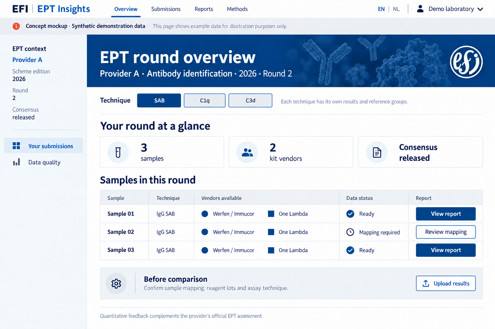
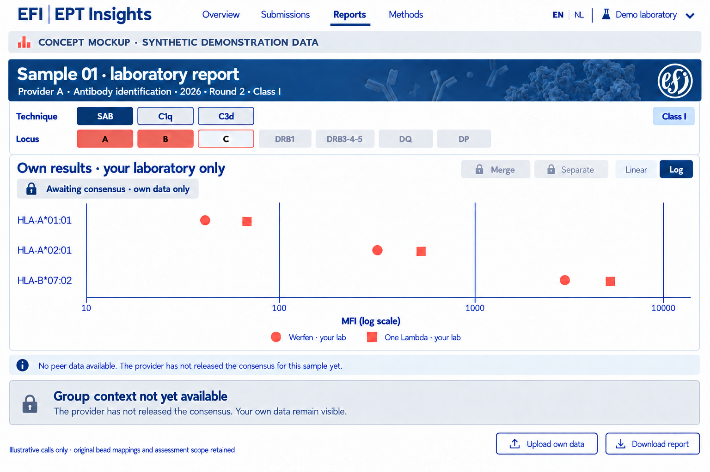
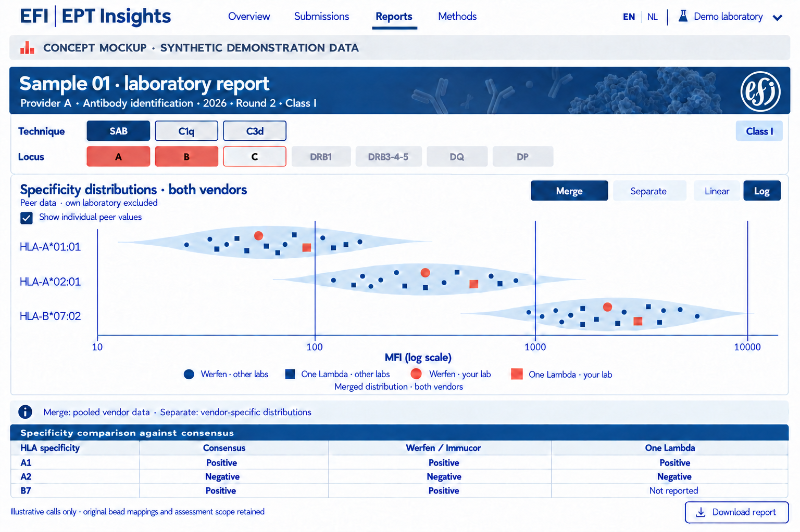

# EFI EPT — platform concept

Version 1.0 · 15 October 2026 · Public design documentation

## Purpose

A bilingual research prototype for supplementary analysis of HLA single antigen bead results within EPT distributions. Participants can inspect their own measurements and compare them with suitable references after provider release. This is a developing design, not an official EFI service, accreditation assessment or medical advice.

## EPT context and identity

The structure is **provider → scheme/year edition → round → sample → technique → lot-specific analytical target**. Identical sample codes at different providers do not identify the same material. Providers, rounds and samples stay separate. Region is organisational metadata, not a peer-group definition. Provider enrolment is recorded only after confirmation.

## Own data and release

A participant can upload, validate and inspect own data before consensus release. Group data remain restricted. The authorised provider uploads officially released consensus with scope and version; validation and processing unlock the matching group context for authorised participants. A date, filename or participant action cannot trigger this.

The first local version processes files solely in the browser. There is no central upload, account environment or production permission model yet. Local demonstration of consensus release is not real provider authorisation. Real collaboration requires private submission contexts and access enforcement.

## Techniques and vendors

Conventional **IgG SAB**, **C1q** and **C3d** are parallel, separate techniques. Shared beadsets do not make measurements or consensus interchangeable. SAB in the interface means IgG SAB. Werfen/Immucor and Thermo Fisher/One Lambda have separate importer adapters; the first implementation starts with Werfen xPONENT CSV + EDS. MATCH IT! follows later. Unvalidated formats are explicitly rejected.

## Laboratory report

Technique offers SAB/C1q/C3d. Locus offers A, B, C, DRB1, DRB3-4-5, DQ and DP. Both rows align; multiple loci can be selected. The chart axis shows bead composition as a **PL String**, never bead numbers as main labels. DQ/DP chains are paired only through confirmed mapping; ambiguous exports are not silently reconstructed.

**Merge** computes one violin from pooled eligible vendor measurements for the same target. **Separate** computes one violin per vendor. Context, technique, quantity and explicit lot selection stay fixed. A laboratory can contribute two vendor measurements while counting once as a unique lab. Show laboratory and measurement counts. Own values are excluded from the reference by default.

MFI axes always start on **log10**, with original MFI units as labels. Zero, negative, missing and invalid remain separate; no silent replacement with 1. Small cohorts do not get artificial violins. Peer points use circles for Werfen and squares for One Lambda, all blue. Own points use the same vendor shape, are larger and coral. Peer points contain no laboratory identity.

## Input and output

Input comprises source exports, technique, lot metadata and confirmed mapping of local samples to the EPT context. EDS files support lot-specific bead annotations. Control beads are distinct from analytical targets. Source values remain unchanged; corrected and normalised measurements are different quantities. HAML can support interchange but does not replace provider/release metadata.

Outputs include import validation, own measurement tables, context-specific charts and reproducible JSON/CSV/SVG exports with source hash, method version, inclusions, exclusions and active filters. Official consensus assignments originate from provider consensus, never a substituted universal MFI cutoff.

## Privacy and publication

This public site contains approved design documentation, style conventions and synthetic illustrations only. Private correspondence, source PDFs, patient fields, tokens and real participant data are not published. Removing names does not automatically make peer data public. GitHub Pages is the public documentation layer; confidential data require a separate private context.

## Design images

The images are synthetic orientation views; implementation uses original logos and SVG components.

## Public sources

- [EFI EPT Committee](https://efi-web.org/efi-committees/ept-committee)
- [EFI EPT providers](https://efi-web.org/efi-committees/ept-committee/ept-providers)
- [HAML](https://github.com/societyforimmunepolymorphism/haml)
- [IHIW converters](https://github.com/IHIW/Converters)
- [hlapro and public mock files](https://github.com/lcreteig/hlapro)
- [PL String specification](https://plstring.org/)

Public source links do not establish collaboration or enrolment. [EFI style guide](style_EN.html).
