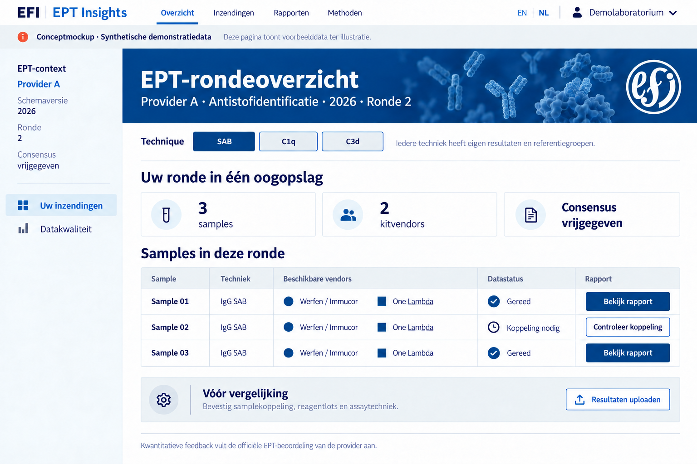
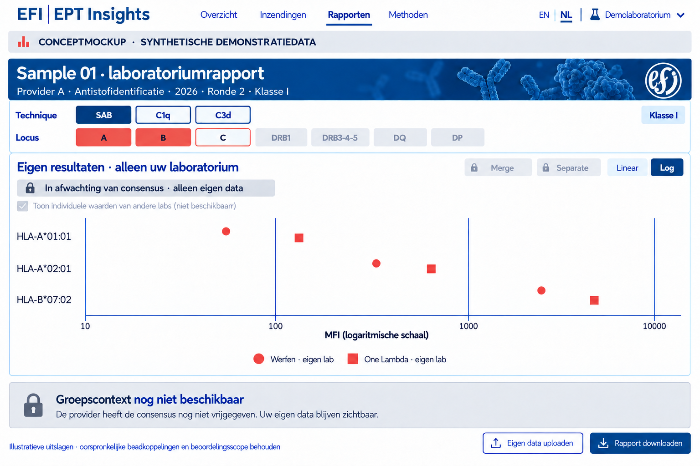
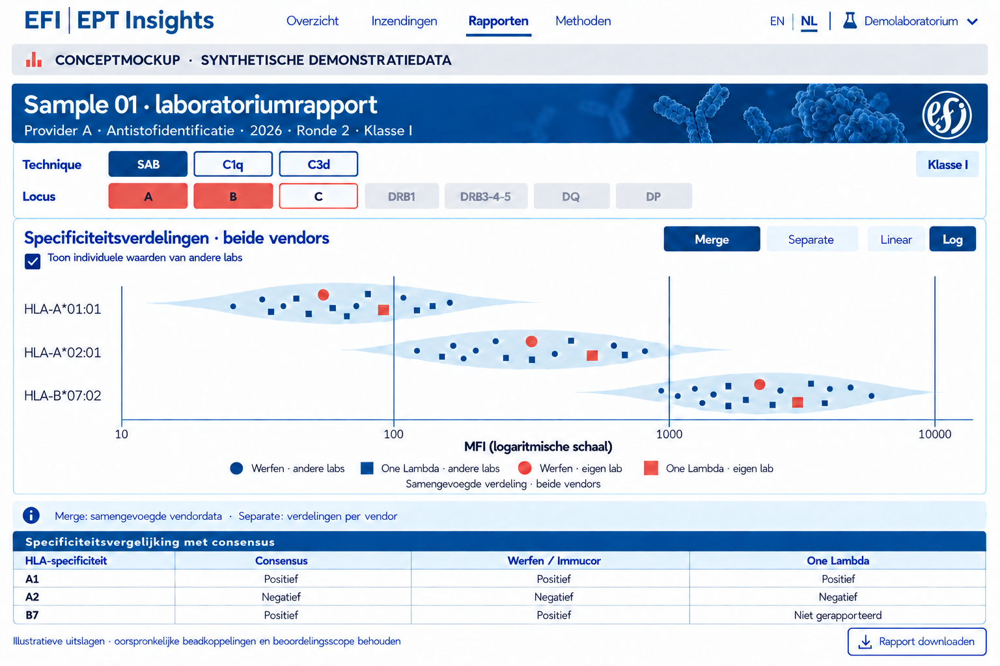

# EFI EPT - concept voor het platform

Versie 1.1 · 16 oktober 2026 · Publieke ontwerpdocumentatie

**Status 16 oktober 2026:** de huidige browserdemo en het voorgestelde centrale platform zijn hieronder afzonderlijk beschreven. Het voorstel voor private opslag, echte login en een externe backend is uitsluitend documentatie; deze functies zijn nog niet gebouwd.

## Doel

Een tweetalig onderzoeksprototype voor aanvullende analyse van HLA single antigen bead-resultaten binnen EPT-rondzendingen. Deelnemers kunnen eigen metingen onderzoeken en die na providervrijgave vergelijken met passende referenties. Dit is een ontwerp in ontwikkeling, geen officiële EFI-dienst, accreditatiebeoordeling of medisch advies.

## EPT-context en identiteit

De structuur is **provider → schema/jaareditie → ronde → sample → techniek → lotgebonden meetdoel**. Gelijke samplecodes bij verschillende providers betekenen niet hetzelfde materiaal. Providers, rondes en samples blijven gescheiden. Regio is organisatiemetadata en bepaalt geen peergroep. De actuele deelname van providers wordt pas na bevestiging geregistreerd.

## Eigen data en vrijgave

Een deelnemer kan vóór consensusvrijgave eigen data uploaden, valideren en bekijken. Groepsgegevens blijven afgeschermd. De bevoegde provider uploadt de officieel vrijgegeven consensus met scope en versie; na validatie en verwerking opent de passende groepscontext voor geautoriseerde deelnemers. Alleen een datum, bestandsnaam of handeling van een deelnemer kan dat niet activeren.

De lokale eerste versie verwerkt bestanden uitsluitend in de browser. Er is nog geen centrale upload, accountomgeving of productierechtenmodel. Een lokale demonstratie van consensusvrijgave is geen echte providerautorisatie. Voor echte samenwerking zijn private inzendcontexten en toegangscontrole nodig.

## Technieken en vendors

Reguliere **IgG SAB**, **C1q** en **C3d** zijn parallelle, afzonderlijke technieken. Gedeelde beadsets maken meetwaarden of consensus niet uitwisselbaar. In de interface staat SAB voor IgG SAB. Werfen/Immucor en Thermo Fisher/One Lambda krijgen afzonderlijke importadapters; de eerste implementatie begint met Werfen xPONENT CSV + EDS. MATCH IT! volgt later. Een ongevalideerd formaat wordt expliciet geweigerd.

## Labrapport

Techniek biedt SAB/C1q/C3d. Locus biedt A, B, C, DRB1, DRB3-4-5, DQ en DP. Beide rijen lijnen uit; meerdere loci zijn selecteerbaar. De grafiekas toont beadsamenstelling als **PL String**, nooit beadnummers als hoofdlabel. DQ/DP-ketens worden alleen gecombineerd bij een bevestigde koppeling; een onduidelijke export wordt niet stilzwijgend gereconstrueerd.

**Merge** berekent één violin uit de samengevoegde geldige vendormetingen voor hetzelfde doel. **Separate** berekent een violin per vendor. Context, techniek, meetgrootheid en expliciete lotselectie blijven gelijk. Een lab kan twee vendormetingen bijdragen maar telt één keer als uniek lab. Toon aantallen labs én metingen. Eigen labwaarden zijn standaard uitgesloten van de referentie.

MFI-assen starten altijd op **log10**, met oorspronkelijke MFI als labels. Nul, negatief, ontbrekend en ongeldig blijven afzonderlijk geregistreerd; geen stille vervanging door 1. Kleine groepen krijgen geen kunstmatige violin. Peerpunten gebruiken cirkels voor Werfen en vierkanten voor One Lambda, allemaal blauw. Eigen punten hebben dezelfde vendorvorm, zijn groter en koraalkleurig. Peerpunten bevatten geen labidentificatie.

## Input en output

Input bestaat uit bronexport, techniek, lotmetadata en bevestigde koppeling van lokale samples aan de EPT-context. EDS-bestanden ondersteunen lotgebonden beadannotaties. Controlebeads worden onderscheiden van meetdoelen. Bronwaarden blijven ongewijzigd; correcties en normalisaties zijn verschillende meetgrootheden. HAML kan een uitwisselingsroute ondersteunen, maar is geen vervanging voor provider- en vrijgavemetadata.

Output omvat importvalidatie, eigen meetwaardetabel, contextgebonden grafieken en reproduceerbare JSON/CSV/SVG-exports met bronhash, methodeversie, inclusies, uitsluitingen en filterinstellingen. Alleen een providerconsensus levert officiële consensusuitslagen; een MFI-cutoff wordt daar niet voor in de plaats gesteld.

## Privacy en publicatie

Deze publieke site bevat uitsluitend goedgekeurde ontwerpdocumentatie, stijlafspraken en synthetische illustraties. Private correspondentie, bron-PDF’s, patiëntvelden, tokens en echte deelnemersdata worden niet gepubliceerd. Het verwijderen van namen maakt peerdata niet automatisch openbaar. GitHub Pages is de publieke documentatielaag; vertrouwelijke data vereisen een afzonderlijke private context.

## Ontwerpbeelden

De beelden zijn synthetische oriëntaties; de implementatie gebruikt originele logo’s en SVG-componenten.







## Publieke bronnen

- [EFI EPT-commissie](https://efi-web.org/efi-committees/ept-committee)
- [EFI EPT-providers](https://efi-web.org/efi-committees/ept-committee/ept-providers)
- [HAML](https://github.com/societyforimmunepolymorphism/haml)
- [IHIW-converters](https://github.com/IHIW/Converters)
- [hlapro en publieke mockbestanden](https://github.com/lcreteig/hlapro)
- [PL String-specificatie](https://plstring.org/)

Publieke bronverwijzingen zijn geen bevestiging van samenwerking of deelname. [EFI-stijlgids](style_NL.html).

## Aparte dashboards per gebruiker

Het dashboard voor deelnemende labs bevat de eigen import, meetwaarden, rapportage en exports. Groepscontext wordt pas zichtbaar na vrijgave door de eigen EPT-provider. Het aparte providerdashboard bevat het overzicht per provider, schema/ editie, ronde, sample en techniek, plus consensusvalidatie en vrijgave. Providers en technieken blijven gescheiden.

In het huidige browserprototype wissel je met de dashboardkeuze tussen deze twee routes. Dit is navigatie binnen een simulatie, geen authenticatie of beveiligde autorisatie. Een nieuwe labimport controleert opnieuw of een geldige lokale demovrijgave voor de actieve context bestaat; anders blijft alleen eigen data zichtbaar.

## Rollen, inloggen en deelnemersworkflow

Er zijn drie demorollen: admin, provider en participant. Admin espierin ziet het accountoverzicht en kan de dashboards voor beide andere rollen bekijken. Provider provider_1 ziet de consensusroute. Participant participant_1 kiest eerst de eigen EPT-schema’s en vendors, importeert daarna CSV en EDS en ziet pas na bevestiging de analyses. De rapportage blijft met de ingeschreven provider en schema-editie gekoppeld. Een One Lambda-deelname kan al worden geregistreerd; de One Lambda-importer is nog niet beschikbaar.

Via Mijn profiel kun je optioneel een e-mailadres toevoegen en je wachtwoord wijzigen. Wachtwoord wijzigen vereist het huidige wachtwoord en een herhaling van het nieuwe wachtwoord. Er worden geen e-mails verstuurd en er is nog geen herstel via e-mail. Bij uitloggen verdwijnen de geïmporteerde resultaten en referentiedata uit de sessie.

Dit is een lokale accountsimulatie op GitHub Pages. De site bevat gezouten PBKDF2-SHA256-verifiers met 210.000 iteraties, geen leesbare startwachtwoorden. Gewijzigde wachtwoorden, e-mail en schema-inschrijvingen staan in localStorage onder ept-demo-accounts-v1 en gelden alleen in deze browser en voor deze site-origin. De login wordt niet bewaard na vernieuwen. Lokale opslag wissen herstelt de oorspronkelijke demoaccounts. Ook met hashes kan browsercode geen echte autorisatie afdwingen; alle publiek gepubliceerde bestanden blijven publiek. Voor productie zijn een authenticatiedienst, beveiligde opslag en controles per rol, provider en inschrijving aan de serverzijde nodig. E-mailverificatie en accountherstel volgen in die fase.

## Onderverdeling van de log-as

De MFI-as start op log10. Hoofdticks markeren de machten van tien. Binnen elke decade komen korte asstreepjes voor de veelvouden 2 tot en met 9, op hun logaritmische positie. Deze onderverdelingen lopen niet als lijnen door de grafiek. De lineaire stand krijgt geen logaritmische tussenstreepjes. SVG-export behoudt de onderverdeling.

## MFI-weergave

Toon MFI-waarden als afgeronde gehele getallen, zonder punt, komma of spatie als duizendtalscheiding. Dit geldt voor tabellen, aslabels en tooltips, in beide talen. Voorbeeld: 8001,5 wordt weergegeven als 8002. Berekeningen en CSV/JSON-data-exports behouden de oorspronkelijke precisie; puntposities worden alleen aan de zichtbare asgrenzen begrensd; SVG-export volgt de visuele integerweergave.

De demovrijgave wordt per provider, schema, ronde, sample, klasse en techniek in deze browser bewaard. Na een overeenkomende deelnemersimport wordt die vrijgave toegepast; intrekken verwijdert deze lokale vrijgave. Andere browsers delen deze status nog niet. Er worden geen ruwe labresultaten centraal opgeslagen.

## Beide demoklassen en vaste MFI-as

De publieke demo bevat standaard klasse I (vier HLA-beads) en klasse II (vijf HLA-beads), elk met een eigen CSV en EDS-lotbestand. Admin en provider krijgen beide demoklassen na inloggen. Een deelnemer bevestigt eerst een publieke demo-import; daarna wordt de andere demoklasse automatisch toegevoegd. Dit geldt uitsluitend voor de publieke demo. Bij eigen bestanden vindt geen automatische bijmenging van demodata plaats. Gebruik de knoppen I en II om te wisselen. Data, lot, loci, meetsectie en consensus blijven per klasse gescheiden; uitloggen wist beide imports.

Alle MFI-grafieken gebruiken een vast zichtbaar bereik van 1 tot en met 30000, zowel logaritmisch als lineair. De log-as heeft hoofdticks op 1, 10, 100, 1000, 10000 en de eindgrens 30000 en korte logaritmische onderverdelingen uitsluitend op de as. Waarden buiten het zichtbare bereik krijgen een gestippelde randmarkering en worden in de toelichting geteld. Brongegevens, berekeningen en numerieke exports behouden hun oorspronkelijke waarde. Tickmarks bij 10, 100, 1000 en 10000 zijn langer dan de tussenstreepjes. Waarden boven 30000 worden op precies 30000 getekend. De vaste as verandert geen meetresultaten.

Vijf extra browsercontroles in `app/tests/classes.cjs` toetsen de standaard klasse-II-import, gepaarde DQ/DP-specificiteiten, terugwisselen naar klasse I, beide vaste assen, waarden onder 1 en boven 30000, exportprecisie en het wissen van beide klassen bij uitloggen.

## Voorgestelde centrale architectuur: status en afbakening

**Ontwerpvoorstel van 16 oktober 2026, nog niet geïmplementeerd.** De huidige lokale browserdemo blijft functioneren zoals beschreven. De repository `ept-data`, onderstaande backend, logindienst en productierechten zijn nog niet aangemaakt. Demoaccounts worden niet automatisch productieaccounts. Deze secties beschrijven de beoogde vervolgfase en vervangen geen bestaande toegangscontrole door een belofte van beveiliging.

De voorkeursopzet houdt de openbare website op GitHub Pages en bewaart toegestane bronbestanden en verwerkte meetbestanden in een afzonderlijke **private repository `ept-data`**. Een externe backend verzorgt echte login, autorisatie, validatie, opslag en rapportlevering. Gebruikers hoeven daarvoor geen GitHub-account of rechtstreekse repositorytoegang te krijgen.

| Onderdeel | Beoogde taak | Plaats en toegang |
| --- | --- | --- |
| Openbare repository `ept` en GitHub Pages | Interface, code, handleiding, stijlgids en toegestane demobestanden | Publiek; geen echte inzendingen of geheime sleutels |
| Private repository `ept-data` | Ongewijzigde toegestane bronnen, genormaliseerde meetbestanden, importmanifesten en consensusversies | Alleen opslagservice en expliciet bevoegde beheerders |
| FastAPI-backend | Sessies/tokens controleren, rol en scope afdwingen, API en exports leveren | Afzonderlijke HTTPS-hosting; draait niet in GitHub Pages |
| PostgreSQL | Accountsleutels, labs, providerrelaties, rollen, goedgekeurde deelnames, taakstatus, bestandsindex en audit | Private database achter de backend |
| Achtergrondworker | Bestanden valideren en verwerken, Git-commits schrijven en index bijwerken | Afzonderlijk werkproces met duurzame taken uit PostgreSQL |
| OpenID Connect-logindienst | Wachtwoorden, e-mailverificatie, herstel en MFA | Beheerde identiteitsdienst; geen wachtwoorddatabase in Git |
| Private tijdelijke bestandsopslag en secretsbeheer | Gecontroleerde uploadbuffer en beveiligde servicesleutels | Backendomgeving, beperkte bewaartijd en toegang |

Dit is een concrete voorkeursstack, geen technische verplichting om Python te gebruiken. Een andere backend is mogelijk als dezelfde autorisatie-, opslag- en verwerkingscontracten worden gerealiseerd. De definitieve hostingpartij, identiteitsdienst, regio, contracten en kosten moeten vóór de bouw worden gekozen.

## Welke backend en hosting zijn nodig?

Minimaal zijn een HTTPS-API, een achtergrondworker, een duurzame PostgreSQL-database, een OpenID Connect-provider en beveiligd secretsbeheer nodig. Voor de pilot kan een PostgreSQL-takentabel de duurzame wachtrij vormen; Redis is dan niet verplicht. De worker draait buiten het webrequest, zodat een upload of GitHub-storing niet afhankelijk is van een open browsertab. Tijdelijke uploads staan versleuteld in private objectopslag en worden na verwerking of afwijzing volgens een ingestelde termijn verwijderd.

FastAPI wordt als containerdienst voorgesteld, met een apart workerproces en een beheerde database. Beide processen moeten na herstart onafgeronde taken betrouwbaar kunnen hervatten. Het voorstel vereist geen eigen fysieke server, maar wel externe reken- en opslagdiensten naast GitHub Pages. GitHub Actions kan later controles of periodieke archivering uitvoeren; het is niet de interactieve login- of toegangsserver.

De backend valideert ook bestanden die al in de browser zijn gecontroleerd. Browservalidatie is alleen gebruikersondersteuning. Ondersteunde formaten, omvang, encoding, lotkoppeling, samples, techniek, klassetoewijzing en meetsecties worden serverzijdig opnieuw gecontroleerd. De eerste centrale importer blijft Werfen xPONENT CSV + EDS; One Lambda, MATCH IT!, C1q en C3d krijgen pas een productiestatus na hun eigen validatie.

Hosting moet HTTPS, vaste toegestane redirect-URL’s, private databaseverbindingen, gescheiden test/productie, monitoring, back-ups en herstel ondersteunen. Voor echte gegevens moeten ook vestigingsregio, bewaartermijnen en organisatorische verantwoordelijkheden worden vastgelegd. Een EU-regio voor API/database betekent niet automatisch dat GitHub-opslag dezelfde gegevenslocatie heeft; de geschiktheid van de gekozen GitHub-dienst moet afzonderlijk worden beoordeeld.

## Echte login en accountlevenscyclus

Voorgesteld wordt OpenID Connect met **Authorization Code + PKCE**, via een daarvoor bedoelde clientbibliotheek. De identiteitsdienst verzorgt aanmelding, e-mailverificatie, wachtwoordwijziging en herstel. MFA wordt vereist voor admin en provider; voor participants wordt het beleid vóór ingebruikname vastgesteld. De publieke demo-startcodes worden niet overgenomen. Productieaccounts ontstaan via een gecontroleerde uitnodiging en bevestigde koppeling aan een lab of provider.

De browser ontvangt uitsluitend kort geldige gebruikerstoegang tot de EPT-API. Langdurige servicesleutels en GitHub-tokens komen nooit in de browser. Toegangstokens worden niet als productie-equivalent van de huidige localStorage-login opgeslagen. De backend controleert handtekening, uitgever, doelgroep en geldigheid van tokens. De onveranderlijke combinatie van identiteitsuitgever en subject identificeert een gebruiker; een e-mailadres of schermnaam is geen blijvende account-ID.

PostgreSQL bewaart het interne gebruikers-ID en de actuele roltoekenningen. Rollen uit een formulier, URL of localStorage zijn nooit gezaghebbend. Een geblokkeerd account, ingetrokken rol of verlopen deelname verliest bij volgende API-controle toegang, ook als een toegangstoken nog niet verlopen is. Productie-uitloggen omvat de applicatiesessie en waar van toepassing de identiteitsdienst; herladen verwijdert centraal opgeslagen inzendingen niet.

Voor de pilot kan de frontend op `espierin.github.io/ept` blijven staan en de API op een andere HTTPS-host met expliciet toegestane CORS-origin. CORS onderscheidt origins, geen projectpaden: `/ept` is geen afzonderlijke origin binnen `espierin.github.io`. CORS is geen autorisatie. Voor productie heeft een eigen, uitsluitend voor EPT gebruikt domein de voorkeur. De toekomstige Content Security Policy moet de gekozen API- en loginhosts expliciet toelaten; de huidige demo blijft ongewijzigd. Een eventuele cookie/BFF-opzet moet apart worden ontworpen, inclusief SameSite, CSRF en het gedrag tussen domeinen.

## Rechtenmodel per rol, lab en provider

Een gebruikersaccount is niet hetzelfde als een laboratorium. Meerdere gebruikers kunnen aan één lab verbonden zijn; een lab kan deelnemen bij meerdere providers en aan meerdere schema’s. Rollen zijn toekenningen met scope, bijvoorbeeld providerbeheer voor één provider en bepaalde schema-edities. Een gebruiker kan meerdere toekenningen hebben, maar de actieve context moet steeds zichtbaar en begrensd zijn.

| Handeling | Participant | Provider | Admin |
| --- | --- | --- | --- |
| Eigen profiel beheren | Eigen account | Eigen account | Eigen account |
| Deelname en vendors aanvragen | Voor gekoppeld lab | Voor eigen organisatie waar van toepassing | Beheer en correctie |
| Deelname goedkeuren | Nee | Alleen eigen provider en schema | Platformbeheer met audit |
| Resultaten insturen en teruglezen | Eigen lab, goedgekeurde deelname en geopende ronde | Eigen providercontext, volgens vastgelegde bevoegdheid | Alleen via expliciete, gelogde beheertoegang |
| Inzendingen van andere labs inzien | Geen ruwe bestanden | Alleen binnen eigen provider en toegewezen schema’s | Expliciete beheertoegang; geen stille labimitatie |
| Consensus voorbereiden, publiceren en intrekken | Nee | Alleen eigen scope | Alleen met expliciete bevoegdheid en reden |
| Groepscontext ophalen | Alleen passend toegelaten lab en geldige vrijgave | Eigen providercontext | Binnen expliciete beheerscope |
| Rollen en providerorganisaties beheren | Nee | Geen platformrollen toekennen | Ja, met audit |

De eerste admin wordt bij een latere ingebruikname expliciet gekoppeld aan de geverifieerde identiteit van de platformbeheerder. De schermnaam `espierin` verleent op zichzelf geen rechten. Er komt geen hardcoded adminwachtwoord of open route om jezelf admin te maken; latere rolwijzigingen gebruiken het geauditeerde beheerproces.

Een participant mag een schema en vendors opgeven, maar dit levert geen zelfverleende toegang op: de provider keurt deelname goed. De backend bepaalt het lab-ID uit de accountkoppeling en controleert de provider-, schema-, ronde- en sampletoegang. Een participant kan geen ander lab kiezen door een ID in een upload of URL te veranderen. Vendorregistratie activeert geen ongevalideerde importer.

Elke lees-, schrijf-, download- en exportaanvraag krijgt dezelfde controles. Standaard wordt toegang geweigerd. Geen enkele rol krijgt via de webapp de volledige private repository of GitHub-toegangstokens. Rechtstreekse GitHub-toegang blijft beperkt tot de opslagservice en aangewezen beheerders, omdat een map geen beveiligingsgrens per lab vormt.

## Indeling en gegevenscontract van ept-data

De naam `ept-data` is de beoogde private repositorynaam; aanmaken is een afzonderlijke toekomstige stap. Er wordt geen GitHub Pages-publicatie voor deze repository ingesteld. De openbare build van `ept` mag de private repository niet ophalen of bestanden daarvan opnemen.

Een mogelijke indeling, uitsluitend als schema en met fictieve interne IDs:

```text
providers/{provider_id}/editions/{edition_id}/rounds/{round_id}/samples/{sample_id}/
  submissions/{submission_id}/revisions/{revision_id}/
    source/run.csv
    source/lot.eds
    normalized/measurements.json
    validation/report.json
    manifest.json
  releases/{technique}/{hla_class}/{release_id}/
    consensus.json
    cohort-manifest.json
    release.json
```

Het inzendmanifest bevat ten minste schema-/parser-/methodeversie, provider, editie, ronde, sample, lab-ID, vendor, techniek, klasse, lot, geselecteerde bronmeting en well, meetsecties, bronhashes, bestandsverwijzingen, invoertijd en revisie. Het cohortmanifest verwijst naar exact de toegelaten inzendrevisies en analysemethode. De fysieke mappen en metadata moeten overeenkomen; de database maakt deze gegevens doorzoekbaar zonder de autorisatie uit paden af te leiden.

Bronbestanden blijven na acceptatie ongewijzigd. Een correctie vormt een nieuwe revisie met verwijzing naar de voorganger en een reden; geen stille overschrijving. Alleen toegestane bronbestanden gaan naar Git. Uploads met niet-toegestane patiënt- of identificatievelden worden vóór archivering tegengehouden; de aanleveraar moet een geschikt bestand leveren. Het stilzwijgend strippen van velden mag een gewijzigd bestand niet als oorspronkelijk presenteren.

Gebruikerswachtwoorden, toegangstokens, e-mailadressenlijsten en de identificerende labnaam-/gebruikerskoppeling worden niet in de meetrepository opgeslagen. Die koppeling staat afgeschermd in de identiteitsdienst/database. Interne IDs verminderen identificatie in bestandsnamen, maar maken de private meetbestanden niet automatisch anoniem of openbaar.

## Opslaan, verwerken en opnieuw ophalen

De deelnemer doorloopt achtereenvolgens **inloggen → goedgekeurde deelname kiezen → bestanden en bronmeting bevestigen → servervalidatie → opslag → eigen analyse**. De server controleert rechten voordat hij een upload aanneemt. Provider, lab en bronkoppeling worden opnieuw gevalideerd; een cliëntverklaring alleen is onvoldoende.

De API kan eerst een taak-ID teruggeven met status `queued`. Dat betekent nog niet dat de inzending duurzaam is opgeslagen. Voorgestelde taakstatussen zijn `queued`, `validating`, `rejected`, `committing`, `indexing` en `available`, met afzonderlijke herstelbare `failed`-status. De interface meldt pas opgeslagen/beschikbaar wanneer Git-commit, bronhashcontrole en database-index bevestigd zijn.

De worker verwerkt de tijdelijke upload, maakt een samenhangende Git-commit voor bronnen, normalisatie en manifest en legt commit-SHA en revisie vast in PostgreSQL. Git en database vormen geen gezamenlijke transactie. Daarom zijn een duurzame taak/outbox, herhaalbare verwerking en een reconciliatiecontrole nodig. Een herstart na een geslaagde commit mag geen dubbele inzending maken. Een idempotentiesleutel omvat de bevestigde inzendcontext; alleen de bestandshash is onvoldoende, omdat hetzelfde bestand meerdere wells of legitieme contexten kan bevatten.

In de pilot wordt één schrijver per repository gebruikt, met controle van de verwachte branch-head en herpoging bij een conflict. Er wordt nooit blind een conflicterende versie overschreven. Wachtrijvertraging, GitHub-limieten en tijdelijke storingen worden als taakstatus teruggegeven. Voor herladen op een ander apparaat haalt de backend de geautoriseerde index en bestanden opnieuw op; de gebruiker krijgt geen rechtstreekse private GitHub-download-URL of repositorytoken.

## Consensusvrijgave als centrale toestand

Vrijgave blijft gebonden aan **provider + schema-editie + ronde + sample + techniek + klasse**, met geldige bron, versie, datum, vastgelegde meetgrootheid en toegelaten lotselectie. Alleen een bevoegde provider, of een expliciet daarvoor bevoegde admin, mag publiceren. Het uploaden van een consensusbestand levert eerst een gevalideerd concept op en opent niet op zichzelf de groepscontext.

Voorgestelde vrijgavestatussen zijn `draft`, `validated`, `published`, `revoked` en `superseded`. Publiceren legt een versie vast, inclusief de consensus en het cohort van geldige inzendrevisies. Nieuwe inzendingen of gewijzigde analyses veranderen een eerder vrijgegeven cohort niet stilzwijgend; daarvoor is een nieuwe cohort-/vrijgaveversie nodig. De officiële consensus blijft de providerbron en wordt niet afgeleid uit een universele MFI-grens.

Voor participants worden groepsgrafieken, peerpunten, groepsstatistieken en bijbehorende exports vóór `published` serverzijdig geweigerd. De backend controleert rol, actuele deelname en vrijgavestatus bij iedere aanvraag. Ook caches zijn per context, recht en versie gescheiden; responses met gevoelige data krijgen een private/no-store-beleid. Een foutieve aanvraag mag geen verborgen peerdataset of downloadbare bron bevatten.

Intrekken sluit volgende groepsaanvragen en ongeldig verklaarde rapportcaches. Eigen inzendingen blijven toegankelijk binnen de geldige rechten. Een reeds gedownloade export kan technisch niet worden teruggehaald; rapporten dragen daarom versie, vrijgavetijd en statusinformatie. Herpublicatie krijgt een nieuwe versie. De huidige browserlokale demovrijgave wordt niet als centrale officiële vrijgave gemigreerd.

## Anonimisering en vergelijking van kwaliteit tussen providers

De backend houdt labidentiteit intern voor autorisatie, ontdubbeling en uitsluiting van het eigen lab. De participant-response bevat geen lab-ID, accountnaam, e-mail, bestandsnaam van een ander lab, verborgen punt-ID of alternatieve route naar diens ruwe bestand. Beide vendors kunnen bijdragen, maar een lab telt één keer als uniek lab. Peerpunten houden de vendorvorm en de gezamenlijke peerkleur; technieken en meetgrootheden blijven gescheiden.

Vóór echte ingebruikname moet een expliciet beleid voor kleine groepen en herleidbare punten worden vastgesteld. De minimale groepsgrootte voor privacy is een andere instelling dan het minimum voor een violin. Een provider mag groepsgegevens eerder intern beoordelen; dit geeft participants nog geen toegang.

Een overkoepelende kwaliteitsanalyse van controles kan alleen via een afzonderlijk geautoriseerd project, met een bevestigde koppeling aan gedeeld controlemateriaal, expliciete providergoedkeuring en passende publicatiescope. Gelijke samplecodes of regio’s vormen geen bewijs van dezelfde controle. EPT-rondes en onbekende samples worden niet bij elkaar gevoegd. Vendorresultaten blijven afzonderlijk interpreteerbaar en kunnen via specificiteitsconsensus worden vergeleken. Dit verleent geen wederzijdse toegang tot private providerreposities of ruwe labdata.

## Voorgestelde API-contracten

Dit zijn ontwerpinterfaces, geen bestaande endpoints. De backend bepaalt scope steeds uit geverifieerde identiteit, databasekoppelingen en de gevraagde EPT-context.

| Interface | Invoer en controles | Beoogde uitvoer |
| --- | --- | --- |
| `GET /me` | Geldige identiteit en accountstatus | Profiel, labs en toegestane rolscopes |
| `POST /participations` | Labkoppeling, provider, editie en vendors | Aanvraag met goedkeuringsstatus, geen automatisch toegangsrecht |
| `POST /imports` | Goedgekeurde deelname, geopende ronde, bronbestanden, techniek en bevestigde well/samplekoppeling | Taak-ID en validatiestatus |
| `GET /jobs/{id}` | Aanvrager of bevoegde provider/admin | Voortgang, bruikbare foutcode en revisieverwijzing |
| `GET /submissions/{id}` | Labbezit of expliciete provider-/beheerscope | Eigen of toegestane inzending op vaste revisie |
| `POST /releases` | Providerbevoegdheid, bronconsensus en context | Gevalideerd concept met fouten of waarschuwingen |
| `POST /releases/{id}/publish` | Opnieuw gecontroleerde bevoegdheid en volledige gevalideerde versie | Gepubliceerde vrijgave en cohortversie |
| `POST /releases/{id}/revoke` | Bevoegdheid en reden | Ingetrokken status en auditverwijzing |
| `GET /group-context` | Actieve deelname, exacte context en gepubliceerde versie | Toegestane grafiekdata en tellingen zonder peeridentiteit |
| `POST /exports` | Dezelfde rechten als de getoonde data, klasse, techniek, filters en versie | Reproduceerbare CSV/JSON/SVG, via geautoriseerde levering |
| `POST /admin/role-grants` | Adminbevoegdheid, scope, doelaccount en reden | Geregistreerde rolwijziging met audit |

## GitHub-koppeling, beheer en groeipad

De backend gebruikt een GitHub App voor de opslagservice, geïnstalleerd op uitsluitend `ept-data`, met minimaal benodigde repositoryrechten, in eerste instantie Contents read/write en noodzakelijke metadata. Geen workflow-, organisatiebeheer- of openbare-site-schrijfrechten. De privésleutel staat in een secretsmanager; kort geldige installation tokens blijven op de server. De service schrijft onder haar eigen technische identiteit; de interne audit legt vast welke geautoriseerde EPT-gebruiker de handeling initieerde. Een gedeeld persoonlijk toegangstoken in de frontend is geen onderdeel van dit ontwerp.

Een audit bevat actor-ID, effectieve rol en scope, actie, doel-ID, tijd, reden, resultaat, bron-/rapportversie en zo nodig commit-SHA. Auditdetails zijn beperkt toegankelijk en bevatten geen wachtwoorden, tokens of onnodige ruwe meetinhoud. De Git-geschiedenis vervangt deze audit niet. Back-ups omvatten repository, database, identiteitsconfiguratie en herstelbare sleutelconfiguratie; herstel moet als samenhangende dataset worden getest.

Vooraf zijn afspraken nodig over bewaartermijn en verwijdering, inclusief Git-geschiedenis, tijdelijke bestanden, caches en back-ups. Een bestand verwijderen uit de actuele branch verwijdert het niet uit oudere commits. Als de vereiste verwijderbaarheid of gegevenslocatie niet met de gekozen GitHub-opslag te realiseren is, moet private objectopslag de meetbestanden bewaren en Git alleen geschikte versiemanifesten. Dat is een expliciet beslispunt vóór opslag van echte gegevens.

GitHub is voor deze opzet een versiearchief voor een afgebakende pilot, geen database voor alle losse meetwaarden of elke grafiekklik. PostgreSQL is de operationele autorisatie- en indexlaag. Omvang, commitsnelheid, wachttijden, conflicten en bewaarbehoefte worden gemeten. Groei of andere bewaareisen kunnen leiden tot objectopslag met dezelfde bestandscontracten en GitHub als manifest-/versiearchief. Er wordt nu geen uitspraak gedaan over kosten of maximale deelnemersaantallen.

## Voorwaarden voor een latere bouwfase

Vóór implementatie moeten hosting/identiteitsdienst, domein, gegevenslocatie, toegestane broninhoud, bewaartermijnen, providerbevoegdheden, deelnamegoedkeuring en het privacybeleid voor kleine groepen worden vastgesteld. Deze uitwerking maakt nog geen externe diensten, sleutels of accounts aan.

De latere acceptatietests moeten minimaal aantonen dat een participant geen ander lab kan kiezen, providers geen andere provider kunnen benaderen, zelfregistratie geen deelname goedkeurt, verborgen endpoints en exports dezelfde rechten afdwingen en blokkeren/intrekken ook met nog geldige tokens effect heeft. Daarnaast: geen peertoegang vóór vrijgave, klasse/techniek/meetsectie niet vermengen, correcte dual-vendor-ontdubbeling, bestandshashes intact, geen dubbele commits bij retries, herstel na storing tussen Git-commit en database-update, en geslaagde back-up-/herstel- en verwijderproeven. Toegangsrechten moeten met echte afzonderlijke accounts en servercontroles worden getest, niet alleen door knoppen te verbergen.

## Technische bronnen bij het architectuurvoorstel

De genoemde productmogelijkheden zijn gecontroleerd op 16 oktober 2026. De architectuurkeuzes hierboven zijn projectvoorstellen, geen door GitHub geleverde EPT-functionaliteit.

- [GitHub Pages is statische hosting](https://docs.github.com/en/pages/getting-started-with-github-pages/what-is-github-pages).
- [GitHub repository contents API](https://docs.github.com/en/rest/repos/contents).
- [GitHub App installation tokens en beperkte repositoryrechten](https://docs.github.com/en/apps/creating-github-apps/authenticating-with-a-github-app/generating-an-installation-access-token-for-a-github-app).
- [GitHub App: sleutels en autorisatie](https://docs.github.com/en/apps/creating-github-apps/about-creating-github-apps/best-practices-for-creating-a-github-app).
- [GitHub repositorylimieten](https://docs.github.com/en/repositories/creating-and-managing-repositories/repository-limits).
- [FastAPI: deploymentconcepten](https://fastapi.tiangolo.com/deployment/concepts/).
- [OAuth 2.0 Security Best Current Practice, RFC 9700](https://www.rfc-editor.org/rfc/rfc9700.html).
